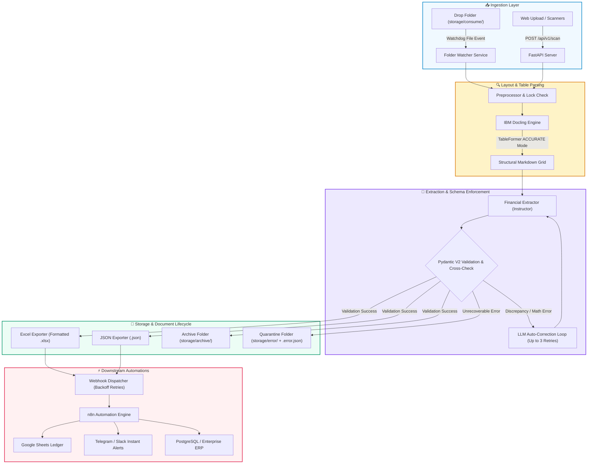
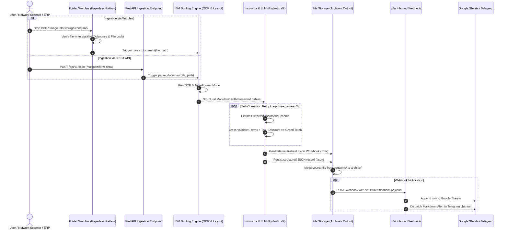
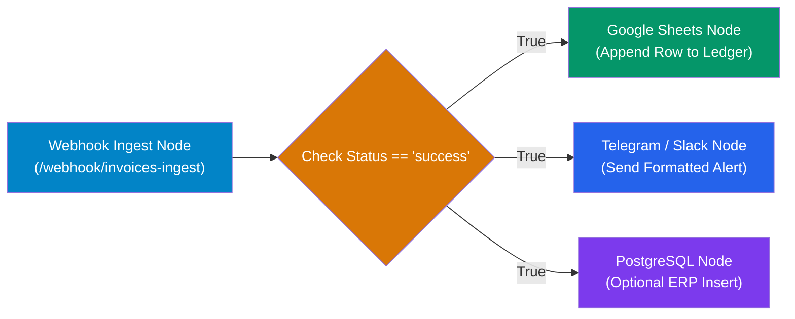

<div align="center">

# 🧾 Smart Invoice & Receipt Scanner
### Industrial Financial Document Extraction & Automated ERP Ingestion Pipeline

[](https://www.python.org/)
[](https://fastapi.tiangolo.com/)
[](https://github.com/DS4SD/docling)
[](https://github.com/jxnl/instructor)
[](https://www.docker.com/)
[](https://opensource.org/licenses/MIT)

*An end-to-end, production-ready system designed to eliminate manual data entry of invoices and receipts across commercial enterprises, trading corporations, and accounting departments.*

</div>

---

## 📌 1. Overview & Core Philosophy

**Smart Invoice & Receipt Scanner** is an enterprise-grade ingestion and extraction pipeline. Instead of reinventing custom OCR or brittle regex parsers, it unifies battle-tested, high-reliability open-source frameworks:

* **[IBM Docling](https://github.com/DS4SD/docling):** Extracts multi-column financial documents and complex tabular layouts into clean, structural Markdown with zero column drift.
* **[Instructor](https://github.com/jxnl/instructor) & Pydantic V2:** Enforces 100% strict mathematical and schema validation over LLM outputs, featuring an automated feedback retry loop (`max_retries=3`) to self-correct calculation discrepancies.
* **[Paperless-ngx](https://github.com/paperless-ngx/paperless-ngx) Ingestion Architecture:** Reliable consumption directory monitoring (`consume/`, `archive/`, `error/`, `output/`) with debounce and file-lock protection.
* **[n8n](https://n8n.io) Production Automations:** Out-of-the-box workflow template to automatically sync validated financial records directly to **Google Sheets**, enterprise **ERP databases**, and **Telegram/Slack alerts**.

---

## 🏛️ 2. System Architecture

The pipeline seamlessly bridges local filesystem consumption, REST API ingestion, intelligent layout analysis, schema enforcement, and downstream automation:



---

## 🔄 3. End-to-End Sequence Flow



---

## 📁 4. Project Directory Structure

```text
smart-invoice-receipt-scanner/
├── .env.example                     # Environment template (API keys, model parameters, paths)
├── .env                             # Local configuration file (git-ignored)
├── .gitignore                       # Production gitignore rules
├── docker-compose.yml               # Multi-container orchestration (Scanner + n8n)
├── Dockerfile                       # Multi-stage production container with Poppler & OCR
├── pyproject.toml                   # Project metadata and dependencies
├── requirements.txt                 # Pinned Python package dependencies
├── main.py                          # Unified CLI entrypoint (serve, watch, scan, run-all)
├── README.md                        # Enterprise technical documentation
│
├── config/                          # Configuration management
│   ├── __init__.py
│   └── settings.py                  # Pydantic-Settings environment loader
│
├── src/
│   ├── core/                        # Core infrastructural modules
│   │   ├── exceptions.py            # Hierarchical domain exceptions
│   │   └── logger.py                # Structured console & rotating file logging
│   │
│   ├── parser/                      # IBM Docling parsing layer
│   │   ├── preprocessor.py          # File readiness, size & extension validation
│   │   └── docling_engine.py        # TableFormer ACCURATE mode & OCR integration
│   │
│   ├── extractor/                   # Instructor & LLM structured extraction
│   │   ├── schemas.py               # Pydantic V2 models for invoices, parties & totals
│   │   └── instructor_client.py     # Instructor client with automated self-correction
│   │
│   ├── services/                    # Export & persistence services
│   │   ├── file_manager.py          # Paperless-ngx lifecycle manager (Archive/Quarantine)
│   │   ├── excel_exporter.py        # Multi-sheet styled Excel workbook generator
│   │   └── webhook_dispatcher.py    # Resilient webhook dispatcher with exponential backoff
│   │
│   ├── watcher/                     # Background filesystem monitoring
│   │   └── folder_watcher.py        # Watchdog monitor for continuous consume/ ingestion
│   │
│   └── api/                         # FastAPI web service
│       ├── app.py                   # FastAPI application with modern lifespan & CORS
│       ├── routes.py                # Endpoints for sync/async scan, health & file downloads
│       └── schemas.py               # Request and response API schemas
│
├── storage/                         # Volume-mountable filesystem directories
│   ├── consume/                     # Drop folder for pending documents
│   ├── archive/                     # Successfully processed documents (timestamped)
│   ├── error/                       # Quarantined documents accompanied by .error.json
│   ├── output/                      # Generated JSON and Excel output reports
│   └── logs/                        # Rotating daily log files
│
├── workflows/                       # Downstream automation blueprints
│   └── n8n_invoice_pipeline.json    # Ready-to-import n8n workflow (Google Sheets & Telegram)
│
└── tests/                           # Automated test suites
    ├── test_schemas.py              # Mathematical consistency & schema validation tests
    ├── test_services.py             # Excel generation and file lifecycle tests
    └── test_api.py                  # FastAPI route & health check tests
```

---

## 🚀 5. Quickstart & Deployment

### Option A: Deployment with Docker Compose (Recommended)

1. **Clone the repository and prepare your environment:**
   ```bash
   git clone https://github.com/ME0W004/smart-invoice-receipt-scanner.git
   cd smart-invoice-receipt-scanner
   cp .env.example .env
   ```

2. **Configure your LLM credentials in `.env`:**
   ```dotenv
   LLM_API_KEY=sk-your_openai_or_deepseek_key_here
   LLM_MODEL_NAME=gpt-4o-mini
   ```

3. **Build and launch the services:**
   ```bash
   docker-compose up -d --build
   ```

4. **Verify running services:**
   * **Interactive Swagger UI:** [http://localhost:8000/docs](http://localhost:8000/docs)
   * **n8n Automation Console:** [http://localhost:5678](http://localhost:5678)

---

### Option B: Local Python Execution

1. **Set up a Python virtual environment:**
   ```bash
   python -m venv .venv
   
   # Linux / macOS:
   source .venv/bin/activate
   
   # Windows:
   .venv\Scripts\activate
   ```

2. **Install dependencies:**
   ```bash
   pip install -r requirements.txt
   ```

3. **Run via CLI:**
   ```bash
   # Run both API and Folder Watcher concurrently:
   python main.py run-all --port 8000

   # Or run API server standalone:
   python main.py serve --port 8000

   # Or run Folder Watcher standalone:
   python main.py watch

   # Or scan a single invoice directly from the CLI:
   python main.py scan path/to/sample_invoice.pdf
   ```

---

## 📡 6. REST API Reference

| Method | Endpoint | Description | Content-Type |
| :--- | :--- | :--- | :--- |
| `GET` | `/api/v1/health` | Service health status & storage telemetry | `application/json` |
| `POST` | `/api/v1/scan` | Synchronously scan document & return extracted JSON | `multipart/form-data` |
| `POST` | `/api/v1/scan/async` | Queue file into consumption folder for background worker | `multipart/form-data` |
| `GET` | `/api/v1/download/{filename}` | Download generated Excel (`.xlsx`) or JSON file | `application/octet-stream` |

### Sample cURL Request

```bash
curl -X POST "http://localhost:8000/api/v1/scan" \
     -H "accept: application/json" \
     -H "Content-Type: multipart/form-data" \
     -F "file=@invoice_sample.pdf"
```

### Sample JSON Output

```json
{
  "status": "success",
  "filename": "invoice_sample.pdf",
  "document": {
    "document_type": "invoice",
    "document_number": "INV-2026-0042",
    "issue_date": "2026-11-05",
    "due_date": "2026-11-20",
    "currency": "USD",
    "vendor": {
      "name": "Acme Global Solutions Ltd",
      "tax_id": "VAT-99887766",
      "phone": "+1-555-0199",
      "address": "400 Innovation Way, Tech Park"
    },
    "customer": {
      "name": "Enterprise Holdings Inc",
      "tax_id": "US-TAX-12345"
    },
    "items": [
      {
        "item_index": 1,
        "sku": "SRV-01",
        "description": "Cloud Hosting Enterprise Tier",
        "quantity": 2.0,
        "unit_price": 500.0,
        "tax_amount": 100.0,
        "total_price": 1100.0
      }
    ],
    "summary": {
      "subtotal": 1000.0,
      "total_discount": 0.0,
      "total_tax": 100.0,
      "shipping_cost": 0.0,
      "grand_total": 1100.0,
      "amount_paid": 0.0,
      "amount_due": 1100.0
    }
  },
  "excel_file": "20261105_150000_invoice_sample.xlsx",
  "json_file": "20261105_150000_invoice_sample.json",
  "webhook_dispatched": true
}
```

---

## 📊 7. Styled Excel Workbook Structure

Every processed document automatically yields a production-grade multi-sheet Excel file (`storage/output/`):

1. **Sheet 1 ("Summary & Overview"):**
   * Document metadata (Type, Number, Issue/Due Dates, Currency).
   * Vendor vs. Customer bilateral party table (Tax IDs, Addresses, Phones, Emails).
   * Financial summary table with formatted currency cells and highlight colors.
2. **Sheet 2 ("Line Items"):**
   * Grid of extracted items with Column headers, zebra styling, SKU, Description, Quantity, Unit Price, Taxes, and Line Totals.
   * Native Excel formula (`=SUM(...)`) for line-item grand total computation.

---

## ⚡ 8. n8n Automation Workflow Setup

A production-ready workflow template is included at [`workflows/n8n_invoice_pipeline.json`](workflows/n8n_invoice_pipeline.json).



1. Open n8n at `http://localhost:5678`.
2. Navigate to **Workflows** → Click **Import from File**.
3. Select `workflows/n8n_invoice_pipeline.json`.
4. Connect your Google Sheets OAuth and specify your Spreadsheet ID.
5. Provide your Telegram Bot Token & Chat ID.
6. Click **Activate** — all incoming scanned invoices will automatically log to Google Sheets and dispatch instant Telegram alerts.

---

## ⚙️ 9. Configuration Matrix (`.env`)

| Parameter | Default | Description |
| :--- | :--- | :--- |
| `LLM_PROVIDER` | `openai` | Provider: `openai`, `deepseek`, `ollama`, `openrouter` |
| `LLM_API_KEY` | `sk-...` | Upstream LLM authorization token |
| `LLM_BASE_URL` | `https://api.openai.com/v1` | OpenAI-compatible API base URL |
| `LLM_MODEL_NAME` | `gpt-4o-mini` | Model identifier (e.g. `deepseek-chat`, `gpt-4o`) |
| `LLM_MAX_RETRIES` | `3` | Instructor validation retry attempts |
| `DOCLING_TABLE_MODE` | `accurate` | Docling table layout mode (`accurate` or `fast`) |
| `DOCLING_DO_OCR` | `true` | Enable OCR for scanned PDFs and raster images |
| `STORAGE_CONSUME_DIR` | `./storage/consume` | Ingestion drop directory |
| `STORAGE_ARCHIVE_DIR` | `./storage/archive` | Successfully processed documents archive |
| `STORAGE_ERROR_DIR` | `./storage/error` | Quarantined failed documents directory |
| `STORAGE_OUTPUT_DIR` | `./storage/output` | Output storage for Excel & JSON |
| `N8N_WEBHOOK_URL` | `http://localhost:5678/...` | Destination URL for n8n webhook |

---

## 🧪 10. Verification & Test Suite

The system includes automated tests covering schema validation, mathematical cross-checking, Excel generation, file management, and API routes:

```bash
pytest -v
```

```text
tests/test_schemas.py::test_invoice_line_item_auto_computation PASSED      [ 14%]
tests/test_schemas.py::test_financial_summary_validation PASSED            [ 28%]
tests/test_schemas.py::test_full_extracted_document_validation PASSED      [ 42%]
tests/test_schemas.py::test_missing_required_fields_raises_validation_error PASSED [ 57%]
tests/test_services.py::test_excel_export_generation PASSED                [ 71%]
tests/test_services.py::test_file_manager_json_export PASSED               [ 85%]
tests/test_api.py::test_health_endpoint PASSED                              [100%]

============================== 7 passed in 5.18s ===============================
```

---

## 🛡️ 11. Error Quarantine & Resilience

* **Zero Data Loss:** Documents that fail layout parsing or validation are never deleted. They are automatically moved into `storage/error/` alongside a timestamped `.error.json` file containing stack traces and context.
* **Non-Blocking Ingestion:** A single malformed PDF will never crash or halt the consumption daemon.
* **Enterprise Logging:** All runtime events are captured via structured console logs and daily rotating logs stored in `storage/logs/`.

---

## 📄 License

This project is open-source software licensed under the [MIT License](LICENSE).
